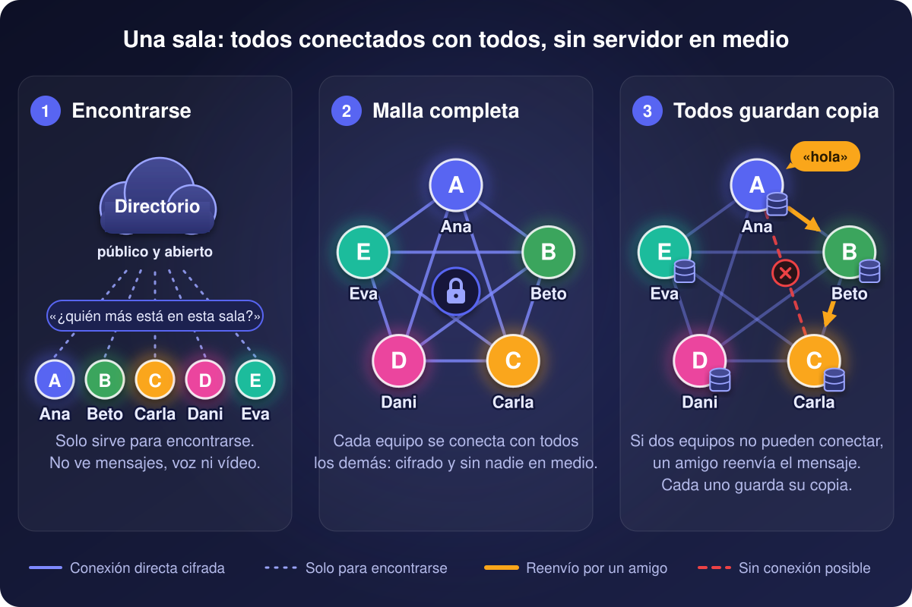
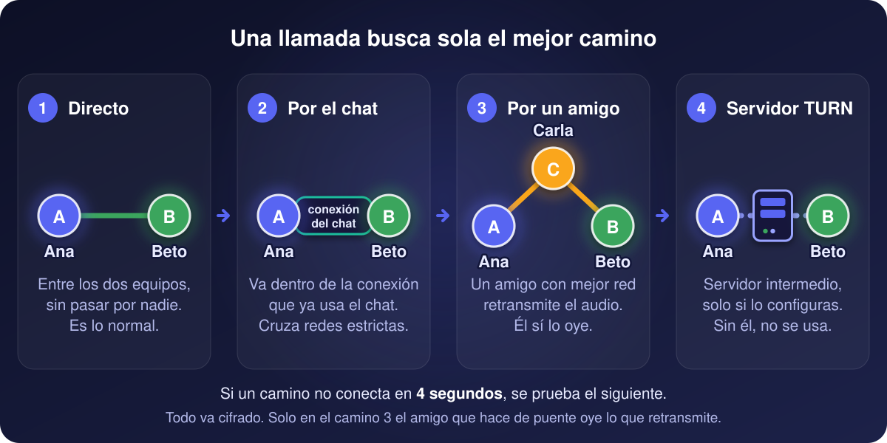

# HumbleChat

Chat de texto, voz y vídeo para un grupo de amigos. Sin cuentas, sin contraseñas y sin servidor propio: las aplicaciones se encuentran y se conectan directamente entre sí. Windows y Linux.

## Qué puedes hacer

- **Varias salas a la vez**, cada una con sus amigos y su propio historial. Pasas de una a otra desde la barra de la izquierda y en las que no miras te llegan los avisos de mensajes sin leer.
- **Canales de texto y de voz** que se crean, renombran y borran. Formato (negrita, cursiva, código), respuestas, ediciones, reacciones, menciones, mensajes fijados, búsqueda y vistas previas de enlaces.
- **Mensajes directos cifrados**, archivos de hasta 64 MB y avatares.
- **Voz, cámara y pantalla compartida** en buena calidad, con supresión de ruido, umbral de sensibilidad y pulsar para hablar con tecla global.
- **Música juntos**: busca una canción por nombre o pega el enlace de un vídeo o de una lista de YouTube y suena a la vez para todos los que quieran escuchar, con cola compartida, pausa, avance y volumen propio. Sin anuncios y también con los vídeos que YouTube no deja incrustar en otras páginas.
- **Utilidades en la llamada**: ruleta con los miembros de la llamada, equipos aleatorios, cara o cruz, dado y orden aleatorio. El resultado es el mismo para todos.
- **Inactividad**: en una llamada, a los 30 minutos sin tocar nada se silencia tu micrófono y a la hora se sale de la llamada (se puede desactivar en Ajustes).
- **Comodidades de escritorio**: bandeja del sistema, inicio automático, aviso de mensajes sin leer y actualizaciones automáticas.

## Instalación

Descarga el archivo de la **última versión** en la página de [Releases](https://github.com/SergioGuillenRuiz/HumbleChat/releases/latest).

| Sistema | Archivo | Cómo instalarlo |
|---|---|---|
| Windows | `HumbleChat-Setup-<versión>.exe` | Ábrelo y sigue el instalador. **Se actualiza solo.** |
| Windows (sin instalar) | `HumbleChat-<versión>-portable.exe` | Ábrelo directamente. No se actualiza solo: hay que descargar la versión nueva. |
| Linux (cualquier distribución) | `HumbleChat-<versión>-x86_64.AppImage` | Dale permiso de ejecución (clic derecho, Propiedades, Permisos) y ábrelo con doble clic. **Se actualiza solo.** |
| Arch / CachyOS | `HumbleChat-<versión>.pacman` | `sudo pacman -U HumbleChat-<versión>.pacman`. Aparece en el menú de aplicaciones. No se actualiza solo. |

En Windows, la primera vez puede salir un aviso de SmartScreen porque el programa no está firmado: pulsa «Más información» y «Ejecutar de todas formas».

### Primer arranque

1. **Si eres el primero del grupo**: elige «Crear una sala nueva», copia el código que aparece y pásaselo a tus amigos.
2. **Si te invitan**: pega el código de sala que te han pasado y pulsa «Entrar». Solo hace falta la primera vez.
3. Cualquier persona de la sala puede volver a ver el código en el menú de la sala, «Invitar a amigos», que también te da el enlace de descarga para pasárselo a otros.

### Actualizaciones

Para que todos hablen el mismo «idioma», **HumbleChat solo funciona si es la última versión publicada**. Al abrirla comprueba si hay una nueva y, si la hay, no se conecta hasta actualizar. Con el instalador de Windows y el AppImage se descarga e instala sola y se reinicia; no tienes que hacer nada. Si la tienes abierta, avisa con 30 segundos de antelación. Con el portable y el `.pacman` te muestra el enlace de descarga.

Para saberlo solo consulta la lista pública de versiones del proyecto; no envía ningún dato tuyo.

## Cómo se usa

- **Salas**: la barra de la izquierda tiene una por sala. Pulsa el «+» para unirte con un código o crear una nueva. Con el botón derecho sobre una sala puedes copiar su código, renombrarla (el nombre solo lo ves tú) o salir de ella, con la opción de borrar su historial de tu equipo.
- **Texto y voz**: elige un canal con `#` para escribir o uno con altavoz para hablar. Abajo a la izquierda están el micrófono, los auriculares y los ajustes; durante una llamada, también la cámara, la pantalla y colgar. Si cambias de sala estando en una llamada, te pregunta antes, porque saldrás de ella.
- **Música**: en una llamada, el botón de la nota (junto a compartir pantalla) abre «Escuchar juntos». Escribe el nombre de una canción (salen resultados para elegir) o pega el enlace de un vídeo o de una lista de reproducción, y se añade a la cola; cualquiera de la llamada puede añadir, pausar, saltar o quitar canciones. A quien llega se le avisa de que hay música, pero solo la oye si pulsa «Escuchar juntos». Ensordecerte la silencia.
- **Utilidades**: el botón del dado (o la llave en la cabecera del canal de voz) abre ruleta, equipos, cara o cruz, dado y orden aleatorio. La ruleta y los equipos traen ya a las personas de la llamada; puedes quitar a alguien o añadir opciones.
- **En privado**: pulsa el nombre de un amigo y «Enviar mensaje».
- **Si algo falla**: Ajustes, Diagnóstico muestra el estado de la red y de la llamada, y cómo se está conectando cada amigo. Es lo que hay que enseñar para que te ayuden.

## Cómo funciona por dentro

La mayoría de los chats funcionan con un **servidor central**: tus mensajes, tu voz y tu cuenta pasan por los ordenadores de una empresa, que es quien los guarda. HumbleChat funciona al revés: **no hay ningún sitio central**, la «sala» son los propios equipos de los amigos.

<p align="center"></p>

- **Encontrarse.** Cuando abres la aplicación, pregunta a un directorio público abierto «¿quién más está en esta sala?» y recibe las direcciones de tus amigos. El directorio no guarda conversaciones: es como una guía telefónica, y solo se usa para este primer paso. La sala se identifica con el **código de sala**, que solo conocéis vosotros.
- **Todos con todos (una malla).** A partir de ahí tu equipo se conecta directamente con **cada uno** de los demás que estén en la sala (todos con todos), con una conexión cifrada y solo con quien conozca el código. No hay nadie en medio ni nadie «al mando»: si falta un equipo, el resto sigue como si nada.
- **Tus mensajes viven en tu equipo.** Cada persona guarda en su ordenador el historial de las salas en las que está. Cada mensaje nuevo se envía a todos y cada equipo lo reenvía a sus vecinos, así que llega incluso a quien no puede conectar directamente con quien lo escribió. Cuando dos amigos se conectan, comparan lo que tienen y se pasan lo que le falta a cada uno. Por eso no hace falta que todos estén conectados a la vez, pero sí que alguien que tenga un mensaje coincida con quien le falta.
- **Quién eres.** Al instalar, la aplicación crea una identidad: una clave secreta que solo existe en tu equipo (no hay cuentas ni contraseñas). Cada mensaje que escribes lleva tu firma, así nadie puede hacerse pasar por ti ni cambiar lo que dijiste. Tu **ID** es la parte pública de esa clave; es la misma en todas tus salas.
- **Cada sala, su mundo.** Cada sala tiene su propia conexión, sus amigos y su historial guardado aparte: lo de una sala nunca se mezcla ni se envía a otra, aunque estés en las dos a la vez.
- **Llamadas.** La voz, la cámara y la pantalla viajan directamente de tu equipo al de cada persona de la llamada, sin pasar por ningún sitio, como una llamada sin central. Como cada uno envía su imagen y su voz a cada uno de los demás, el esfuerzo crece con la gente: por eso está pensado para unas 6 personas por llamada. Algunas redes (los datos del móvil o los routers muy estrictos) no dejan que dos equipos se conecten así; en ese caso la aplicación hace pasar la llamada por la misma conexión que ya usa el chat, y si tampoco es posible, otro amigo con mejor conexión hace de puente. Todo va cifrado por el camino; solo en este último caso, el amigo que hace de puente oye el audio que retransmite.
- **Música.** Por la llamada no viaja audio de música: cada persona que decide escuchar reproduce su propia copia desde YouTube, y las aplicaciones se pasan entre sí un estado muy pequeño (qué canción, si suena, en qué segundo) para ir a la vez. YouTube se abre en una ventana aparte y oculta, sin acceso a nada de tu chat, y se le quitan los anuncios para que todos se mantengan a la vez.
- **Actualizaciones.** Cada versión nueva es obligatoria para que todos se entiendan; la aplicación la descarga sola de la página de versiones del proyecto.

<p align="center"></p>

### En qué se diferencia de un chat con servidor

| | Chat con servidor central | HumbleChat |
|---|---|---|
| **Dónde están tus mensajes** | En los servidores de una empresa | En los equipos de los miembros de la sala |
| **Cuenta** | Correo, contraseña y datos personales | Ninguna: tu identidad se crea sola y solo existe en tu equipo |
| **Quién puede leerlos** | Quien administra el servicio | Solo los miembros de la sala |
| **Si el servicio cierra o cambia las reglas** | Se pierde el historial y las salas | No hay nada que cerrar: cada miembro conserva su copia |
| **Coste** | Planes de pago para archivos grandes o más calidad | Gratis, sin límites que dependan de un plan |
| **Cuando estás desconectado** | El servidor guarda lo que te pierdes | Lo recibes al coincidir con un amigo que lo tenga |
| **Tamaño** | Comunidades de miles de personas | Grupos de amigos: pensado para unas 6 personas en una llamada |
| **Permisos y moderación** | Roles, expulsiones, administradores | Quien tiene el código de sala es miembro y ve el historial |

Lo que se cede a cambio de no depender de nadie, dicho claro:

- Si nadie de la sala está conectado, no hay forma de recibir lo que se escribió mientras tanto.
- Para dejar fuera a alguien no se le puede «expulsar»: se crea una sala nueva y se reparte el código nuevo solo a quienes deban entrar. El historial no se traslada.
- Los mensajes directos ocultan su contenido, no su existencia: el resto de la sala puede ver que dos personas se escriben y cuándo.
- El historial se guarda **sin cifrar** en el disco de cada equipo: quien tenga acceso a tu ordenador puede leerlo.
- El audio del sistema al compartir pantalla solo existe en Windows y puede incluir las voces de la llamada. En Wayland la tecla global de pulsar para hablar puede no funcionar.

## Servicios externos

Gratuitos, sin cuenta ni clave. Ninguno ve mensajes, audio ni vídeo. Hace falta conexión a Internet.

| Servicio | Para qué |
|---|---|
| Nodos de arranque de la red de Hyperswarm | Que las aplicaciones se encuentren |
| Servidores STUN de Google, Cloudflare y Twilio | Averiguar la dirección pública para las llamadas |
| GitHub | Avisar de versiones nuevas y descargarlas |
| Las páginas que enlazas | Solo quien envía el enlace visita la página, una vez, para la vista previa |
| YouTube (solo si usas «Escuchar juntos») | Quien busca o añade una canción consulta su título; quien escucha abre YouTube en la ventana oculta, que ve su dirección y qué vídeo es, pero no la sala ni la llamada |

Para no depender de los públicos, `node scripts/own-node.js --host <IP pública>` en un equipo con IP pública genera un `network.json` (admite también un servidor TURN) que se coloca en la carpeta de datos de la aplicación.

## Desarrollo

Para quien quiera ejecutar o modificar el código (los usuarios no necesitan nada de esto). Requisitos: Node.js 22 y Git.

```bash
git clone https://github.com/SergioGuillenRuiz/HumbleChat.git
cd HumbleChat
npm install
npm start            # ejecutar sin compilar
npm run verify       # todas las pruebas (con Electron real)
npm run dist:public  # instaladores sin llave de sala, para publicar
```

`npm run dist:all` compila Linux y Windows (`dist:win` hay que ejecutarlo desde Windows) e incluye dentro la llave de la sala (`group.key`): es para uso privado, no lo publiques. Las versiones se publican con el flujo «Nueva versión» de GitHub Actions.
